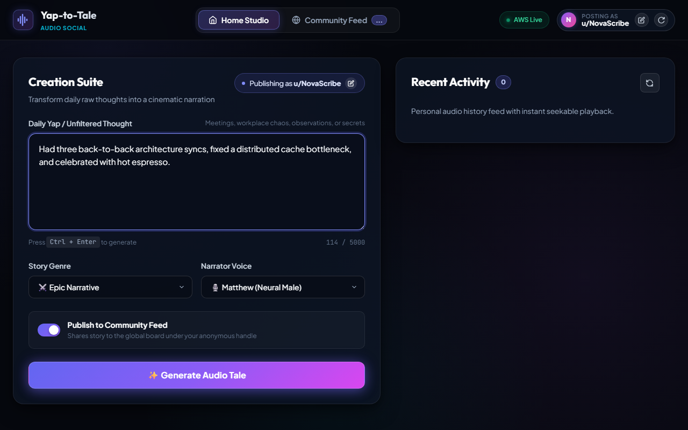
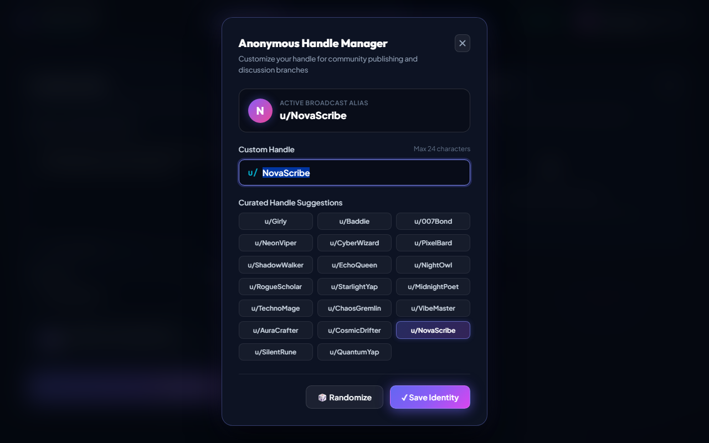
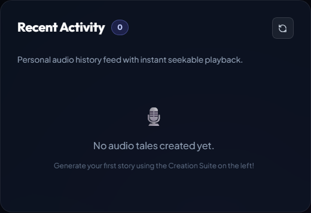
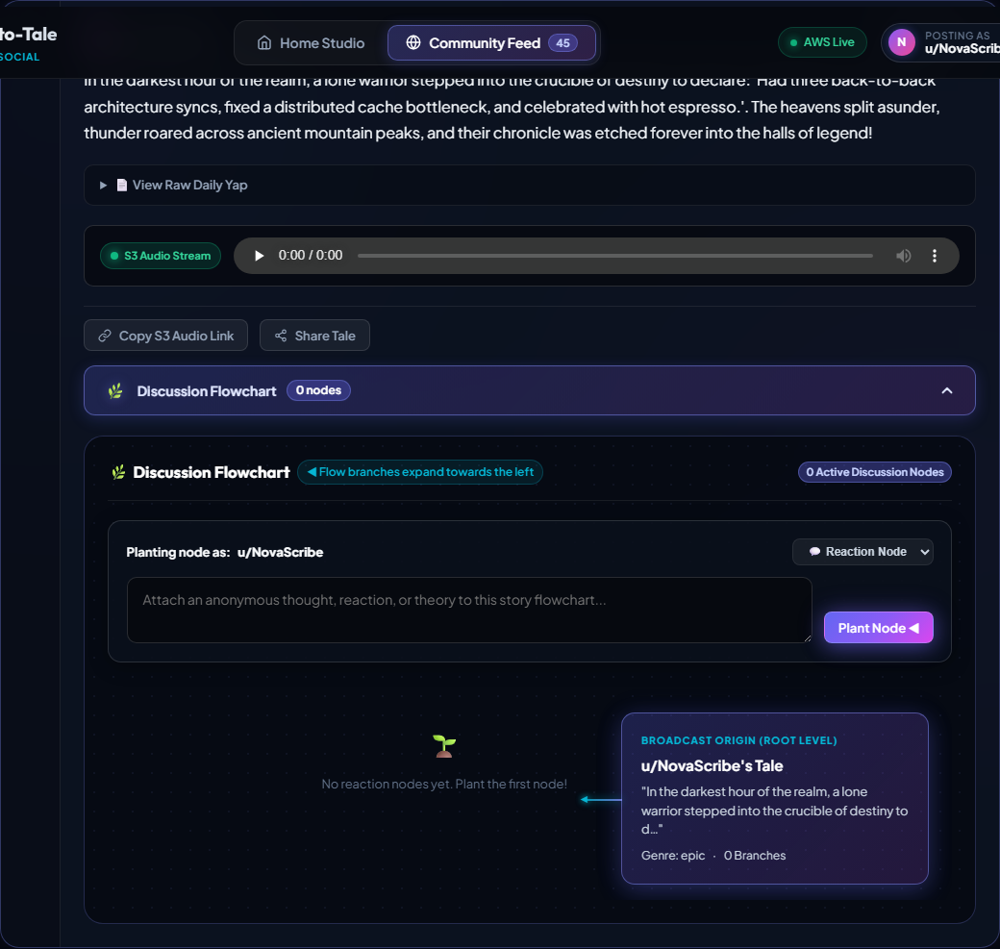

<div align="center">

# 🎙️ Yap-to-Tale
### Cloud-Native Generative AI & Anonymous Audio Social Platform

[](https://yap-to-tale.vercel.app/)
[](#-production-release)
[](#-part-2-technical-specifications--docker-setup-guide)
[](#-kubernetes-deployment)

<p align="center">
  <strong>Transform raw, unfiltered daily thoughts ("yaps") into cinematic audio tales powered by Amazon Bedrock, AWS Polly, Amazon S3, and Amazon DynamoDB with interactive leftward-branching discussion flowcharts.</strong>
</p>

[🌐 Live Demo](https://yap-to-tale.vercel.app/) • [Architecture](#-system-architecture--data-flow) • [Tech Stack](#-tech-stack-breakdown) • [Visual Showcase](#-website-screenshots--interactive-demo-cards) • [Docker Setup](#-part-2-technical-specifications--docker-setup-guide)

---

</div>

## 📑 Table of Contents

- [Part 1: Overview, Architecture & Visual Showcase](#-part-1-overview-architecture--visual-showcase)
  - [Project Capabilities](#-project-capabilities)
  - [System Architecture & Data Flow](#-system-architecture--data-flow)
  - [Tech Stack Breakdown](#-tech-stack-breakdown)
  - [Website Screenshots & Interactive Demo Cards](#-website-screenshots--interactive-demo-cards)
- [Part 2: Technical Specifications & Docker Setup Guide](#-part-2-technical-specifications--docker-setup-guide)
  - [Directory & File Structure](#-directory--file-structure)
  - [Repository Cloning](#-repository-cloning)
  - [Prerequisites & Environment Configuration](#-prerequisites--environment-configuration)
  - [Exclusive Docker Deployment Workflow](#-exclusive-docker-deployment-workflow)
  - [Kubernetes Cluster Deployment](#-kubernetes-cluster-deployment)
  - [API Endpoints Reference](#-api-endpoints-reference)

---

# 🌟 Part 1: Overview, Architecture & Visual Showcase

## 🚀 Live Application
> **Production Deployment:** [https://yap-to-tale.vercel.app/](https://yap-to-tale.vercel.app/)  
> Experience real-time AI story generation, direct S3 audio streaming, anonymous handle management, and leftward discussion flowcharts live in the browser.

---

## 💡 Project Capabilities

**Yap-to-Tale** is an enterprise-grade, cloud-native generative AI microservice and Reddit-style anonymous social audio platform. The application is strictly stateless and acts as a zero-touch media production pipeline:

1. **Unstructured Micro-Log Ingestion ("Yaps")**:
   - Ingests freeform raw daily notes, meeting reflections, workplace updates, or personal confessions up to 5,000 characters.
2. **Atmospheric AI Story Transformation**:
   - Leverages **Amazon Bedrock (Anthropic Claude 3)** to restructure everyday logs into rich short narratives across 8 curated genres:
     - ⚔️ **Epic Narrative**: Heroic chronicles, dramatic turning points, legendary stakes.
     - 🧙 **High Fantasy**: Enchanted realms, ancient arcane secrets, mythical prophecies.
     - 👁️ **Psychological Horror**: Unsettling whispers, eerie dread, atmospheric tension.
     - 🚀 **Sci-Fi Odyssey**: Deep space orbit logs, quantum anomalies, synthetic cores.
     - 🌹 **Poetic Romance**: Intimate realizations, emotional resonance, tender encounters.
     - 🕵️ **Noir Mystery**: Cryptic dossiers, smoke-filled investigative deduction.
     - ⚡ **High-Stakes Thriller**: Encrypted burner transmissions, ticking countdowns.
     - 🎭 **Witty Comedy**: Satirical primetime situational irony and absurd observations.
3. **In-Memory Neural Speech Synthesis**:
   - Converts generated narrative text into studio-grade 24kHz MP3 audio streams via **AWS Polly** (neural and standard engine failover) using in-memory `io.BytesIO` buffers. No temporary files are written to container disk.
4. **Direct Amazon S3 Media Streaming Engine**:
   - Streams MP3 audio directly from Amazon S3 with support for HTTP Range requests (`RFC 7233`), enabling low-latency scrubbing and seekable cross-tab playback.
5. **Dual-Indexed Publishing & Anonymous Identity Management**:
   - Stories are dual-indexed into **Amazon DynamoDB**:
     - *Creator's Personal Studio* ("My Yaps" partitioned by session and anonymous alias).
     - *Global Community Board* (Reddit-style public board with upvote ranking and sorting).
   - Dynamic anonymous identity generator (`u/Girly`, `u/Baddie`, `u/007Bond`, `u/NeonViper`, etc.) with real-time avatar generation and session synchronization.
6. **Interactive Leftward-Branching Flowchart Discussions**:
   - Each shared community audio tale features an expandable discussion flowchart branching towards the left:
     - **Story Origin Node (Right)** acts as the broadcasting root level.
     - **Discussion Nodes (Center & Left)** branch leftwards via directional connector stems (`◀`), categorized into *💬 Reactions*, *💡 Theories*, *🔥 Hot Takes*, and *✨ Praise*.
     - Users can plant new discussion nodes directly into the tree using the inline anonymous node composer.

---

## 🏗️ System Architecture & Data Flow

```
                                      ┌────────────────────────────────────────────────────────┐
                                      │                     CLIENT BROWSER                     │
                                      │  • Home Studio (Creation Suite & Recent Activity)     │
                                      │  • Community Feed & Leftward Flowchart Discussions     │
                                      │  • Anonymous Handle Management Modal                   │
                                      └───────────────────────────┬────────────────────────────┘
                                                                  │
                                            HTTP REST / JSON      │  Range Audio Streaming
                                            X-User-Handle Headers │  (RFC 7233)
                                                                  ▼
┌──────────────────────────────────────────────────────────────────────────────────────────────────────────────────────────────┐
│                                             FLASK MICROSERVICE CONTAINER (PYTHON 3.12)                                        │
│                                                                                                                              │
│  ┌───────────────────────┐    ┌───────────────────────────┐    ┌──────────────────────────┐    ┌──────────────────────────┐  │
│  │  Identity & Session   │    │  Story Transformation     │    │  Direct S3 Audio Stream  │    │  Flowchart & Discussions │  │
│  │  Manager              │    │  Pipeline Controller      │    │  Engine                  │    │  Engine                  │  │
│  └───────────────────────┘    └─────────────┬─────────────┘    └────────────┬─────────────┘    └────────────┬─────────────┘  │
└─────────────────────────────────────────────┼───────────────────────────────┼───────────────────────────────┼────────────────┘
                                              │                               │                               │
                      ┌───────────────────────┴───────────────────────┐       │                               │
                      ▼                                               ▼       ▼                               ▼
       ┌─────────────────────────────┐                 ┌─────────────────────────────┐ ┌─────────────────────────────┐
       │       AMAZON BEDROCK        │                 │          AMAZON S3          │ │       AMAZON DYNAMODB       │
       │  Anthropic Claude 3 Sonnet  │                 │   Audio Media Storage       │ │   Dual-Indexed Social Store │
       │  (Atmospheric Transformation│                 │  • Direct Buffer Upload     │ │  • Partition Key: id        │
       │   across 8 Story Genres)    │                 │  • 7-Day Presigned URLs     │ │  • Global Feed & My Yaps    │
       └──────────────┬──────────────┘                 │  • Byte-Range Seek Support  │ │  • Flowchart Nodes & Upvotes│
                      │ Text Narrative                 └──────────────▲──────────────┘ └─────────────────────────────┘
                      ▼                                               │
       ┌─────────────────────────────┐                                │
       │          AWS POLLY          │                                │
       │     Neural Voice Engine     │────────────────────────────────┘
       │  • In-Memory BytesIO Stream │   In-Memory MP3 Buffer Stream
       │  • 24kHz Studio Audio       │
       └─────────────────────────────┘
```

---

## 💻 Tech Stack Breakdown

| Layer | Technology | Version | Purpose & Architecture Role |
| :--- | :--- | :--- | :--- |
| **Backend Core** | **Python** | `3.12-slim` | Runtime environment for stateless microservice execution. |
| **Web Framework** | **Flask** | `3.1.x` | RESTful API routing, security headers (HSTS, nosniff), and asset serving. |
| **WSGI Server** | **Gunicorn** | `23.x` | Production concurrent WSGI HTTP server with worker concurrency. |
| **Cloud SDK** | **Boto3 / Botocore** | `1.38.x` | Low-latency AWS API client for Bedrock, Polly, S3, and DynamoDB. |
| **Generative LLM** | **Amazon Bedrock** | Claude 3 Sonnet | Neural language model transforming raw micro-logs into genre narratives. |
| **Speech Synthesis** | **AWS Polly** | Neural Engine | Converts story text into studio-grade MP3 audio (Matthew, Joanna, Amy, Brian). |
| **Media Storage** | **Amazon S3** | Standard Tier | Bucket storing in-memory MP3 streams with presigned URLs and range streaming. |
| **NoSQL Database** | **Amazon DynamoDB** | On-Demand | Dual-indexes stories, anonymous handles, upvote scores, and flowchart comment trees. |
| **Frontend Core** | **HTML5 / CSS3 / Vanilla JS** | ES2024 | Modern dark-mode interface with zero heavy UI framework dependencies. |
| **Typography** | **Google Web Fonts** | Hosted | *Plus Jakarta Sans* (UI), *Outfit* (Headings), and *JetBrains Mono* (Code). |
| **Containerization** | **Docker** | Multi-stage | Secure non-root container with explicit health probes and layer caching. |
| **Orchestration** | **Docker Compose** | Compose v2 | Unified multi-container environment orchestration. |
| **Cloud Orchestration**| **Kubernetes (EKS)** | `apps/v1` | 3-replica production deployment with LoadBalancer service manifests. |

---

## 📸 Website Screenshots & Interactive Demo Cards

<div align="center">

### 1. Creation Suite & Generation Interface
*Transform unfiltered logs into epic audio with real-time Polly playback, genre selection, and voice controls.*



---

### 2. Anonymous Identity Management Modal
*Customizable anonymous broadcast handle manager featuring live avatar preview, handle prefixing, and curated suggestions grid.*



---

### 3. Dual-Feed Recent Activity ("My Yaps")
*Personal studio feed tracking active session audio creations, seekable media players, and discussion jumps.*



---

### 4. Community Feed & Leftward Flowchart Comments
*Modular community audio cards with bottom dropdown toggle expanding into an interactive leftward-branching discussion flowchart.*



</div>

---

# ⚙️ Part 2: Technical Specifications & Docker Setup Guide

## 📂 Directory & File Structure

```
Yap-To-Tale/
├── .env.example                 # Environment variables template
├── .gitignore                   # Git exclusion rules
├── Dockerfile                   # Multi-stage production Docker container definition
├── docker-compose.yml           # Docker Compose orchestration specification
├── requirements.txt             # Python backend dependencies
├── setup_dynamodb.py            # Automated DynamoDB table provisioning script
├── vercel.json                  # Serverless production deployment configuration
├── app/
│   ├── app.py                   # Main Flask application & AWS pipeline controller
│   └── static/                  # Production frontend assets
│       ├── app.js               # Reactive UI logic, modal handlers & flowchart engine
│       ├── favicon.ico          # Browser favicon
│       ├── favicon.png          # High-resolution app icon
│       ├── index.html           # Single-page application markup
│       ├── og-preview.png       # Open Graph social preview banner
│       └── style.css            # Modern cyber-dark glassmorphism design system
├── docs/
│   └── screenshots/             # Production UI showcase screenshots
│       ├── anonymous_modal.png
│       ├── flowchart_comments.png
│       ├── generation_interface.png
│       └── recent_tab.png
└── k8s/                         # Kubernetes cloud manifests
    ├── deployment.yaml          # 3-replica K8s Deployment with health probes
    └── service.yaml             # K8s LoadBalancer Service manifest
```

---

## 📥 Repository Cloning

Clone the repository to your local workstation:

```bash
# Clone the repository via HTTPS
git clone https://github.com/sooriya-moorthy-0107/Yap-To-Tale.git

# Navigate into the project directory
cd Yap-To-Tale
```

---

## 🔑 Prerequisites & Environment Configuration

### Required AWS IAM Permissions
To run with live AWS cloud services, your AWS IAM user or role requires permissions for:

| Service | IAM Actions | Purpose |
| :--- | :--- | :--- |
| **Amazon Bedrock** | `bedrock:InvokeModel` | Anthropic Claude 3 story transformation |
| **AWS Polly** | `polly:SynthesizeSpeech` | Neural speech audio generation |
| **Amazon S3** | `s3:PutObject`, `s3:GetObject` | Uploading and streaming generated MP3s |
| **Amazon DynamoDB** | `dynamodb:PutItem`, `dynamodb:GetItem`, `dynamodb:UpdateItem`, `dynamodb:Scan` | Storing tales, comments, and upvotes |

> **Note on Demo Mode:** If AWS credentials are not configured or `MOCK_AWS=true` is set, the application automatically activates **Demo / Mock Mode** with simulated narrative transformation and fallback audio streaming for offline local evaluation.

### Setting Up Environment Variables

Create your local `.env` file from the provided template:

```bash
cp .env.example .env
```

Edit `.env` with your specific parameters:

```ini
# =============================================================================
# Yap-to-Tale Environment Variables
# =============================================================================

# AWS Region & Credentials
AWS_REGION=us-east-1
AWS_ACCESS_KEY_ID=your_aws_access_key_id
AWS_SECRET_ACCESS_KEY=your_aws_secret_access_key

# Storage & Database Resources
S3_BUCKET_NAME=your-s3-bucket-name
DYNAMODB_TABLE_NAME=yap-to-tale-records

# AI Models & Voice Preferences
BEDROCK_MODEL_ID=us.anthropic.claude-3-sonnet-20240229-v1:0
POLLY_VOICE_ID=Matthew

# Local Offline Simulation Mode (true / false)
MOCK_AWS=false

# Flask Environment
FLASK_ENV=production
```

---

## 🐳 Exclusive Docker Deployment Workflow

Execution is performed strictly via Docker containerization and Docker Compose orchestration.

### Method A: Docker Compose Orchestration (Recommended)

Docker Compose builds the image, attaches environment variables from `.env`, runs health checks, and starts the container:

```bash
# Build and run the containerized application in detached mode
docker compose up --build -d
```

#### Monitor Container Health & Execution:

```bash
# View real-time container status and healthcheck probe results
docker compose ps

# Follow container application logs
docker compose logs -f yap-to-tale
```

#### Stopping the Service:

```bash
docker compose down
```

---

### Method B: Direct Docker Build & Run

If running with raw Docker commands:

```bash
# 1. Build the production Docker image
docker build -t yap-to-tale:latest .

# 2. Run the container with your environment configuration
docker run -d \
  --name yap-to-tale-app \
  -p 5000:5000 \
  --env-file .env \
  --restart unless-stopped \
  yap-to-tale:latest

# 3. Verify container is healthy
docker ps --filter "name=yap-to-tale-app"

# 4. View application logs
docker logs -f yap-to-tale-app
```

Once running, access the application in your browser at:  
👉 **`http://localhost:5000`**

---

## ☸️ Kubernetes Cluster Deployment

For production deployments onto Kubernetes clusters (AWS EKS, GKE, or local Minikube):

```bash
# 1. Create AWS credentials secret in your K8s namespace
kubectl create secret generic aws-credentials \
  --from-literal=aws-access-key-id="YOUR_AWS_ACCESS_KEY_ID" \
  --from-literal=aws-secret-access-key="YOUR_AWS_SECRET_ACCESS_KEY"

# 2. Apply deployment and service manifests
kubectl apply -f k8s/deployment.yaml
kubectl apply -f k8s/service.yaml

# 3. Verify pod replicas (3 Replicas configured with readiness probes)
kubectl get pods -l app=yap-to-tale

# 4. Obtain external LoadBalancer IP / URL
kubectl get svc yap-to-tale-service
```

---

## 📡 API Endpoints Reference

| Method | Endpoint | Description |
| :--- | :--- | :--- |
| `GET` | `/` | Serves the single-page application frontend (`index.html`). |
| `GET` | `/health` | Kubernetes & Docker healthcheck probe (returns HTTP 200). |
| `POST` | `/api/transform` | Ingests raw yap, invokes Bedrock & Polly, streams to S3, indexes in DynamoDB. |
| `GET` | `/api/feed` | Retrieves public community board stories (supports `sort=new\|top` and genre filter). |
| `GET` | `/api/my-yaps` | Retrieves creator history filtered by session ID or anonymous handle. |
| `GET` | `/api/audio/<audio_id>` | Direct S3 MP3 stream supporting HTTP Range headers (`RFC 7233`). |
| `POST` | `/api/posts/<id>/upvote` | Atomically increments story upvote score in DynamoDB. |
| `GET` | `/api/posts/<id>/comments` | Retrieves public discussion thread comments. |
| `POST` | `/api/posts/<id>/comments` | Adds an anonymous reaction or theory node to the flowchart comment tree. |
| `GET` | `/api/identity/random-handle`| Generates a random catchy anonymous broadcast handle. |

---

<div align="center">

**Yap-to-Tale** • Built with ❤️ for cloud-native storytelling.

[Back to Top ↑](#-yap-to-tale)

</div>